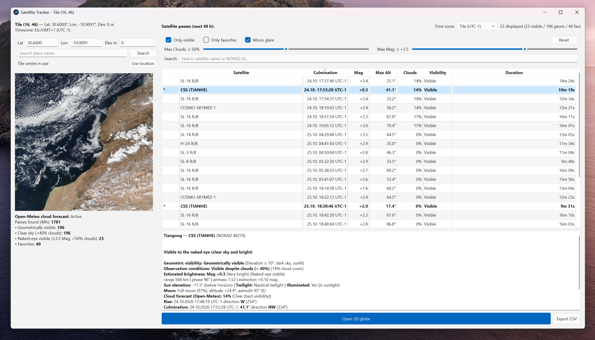
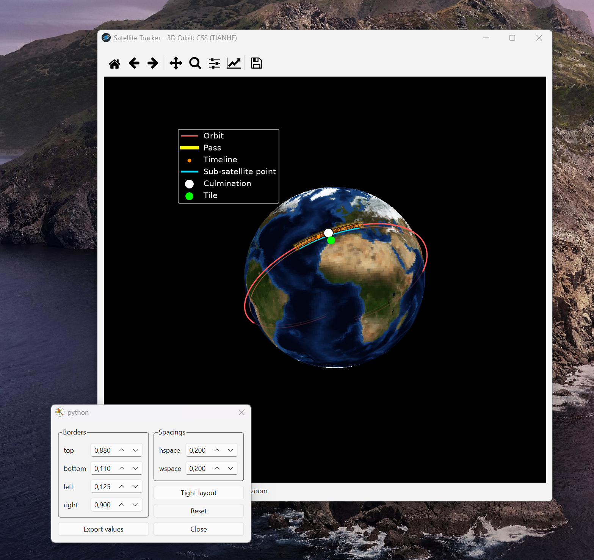

# Satellite Tracker

I built a desktop app that shows you which satellites will fly over any place on Earth in the next 48 hours and if you are able to see them with your own eyes.

**[⬇️ Download the latest release](https://github.com/javinwittig/satelite_tracker/releases/latest)**

---

## Quick start

Download the version for your system from the [releases page](https://github.com/javinwittig/satelite_tracker/releases/latest), unpack it, start `SatelliteTracker`, and click anywhere on the world map. No Python needed.

| System | File |
|---|---|
| Windows (64-bit) | `SatelliteTracker-windows-x64.zip` |
| Linux (64-bit) | `SatelliteTracker-linux-x64.tar.gz` |
| macOS (Apple Silicon, M1 and newer) | `SatelliteTracker-macos-arm64.zip` |

- **macOS:** the app is not signed — right-click it and choose *Open* the first time.
- **Linux:** some distributions also need the `libxcb-cursor0` package.
- Downloaded data (orbits, weather, images) is cached in `~/.satellite_tracker`.

## Features

- **Click anywhere on the world map** or search by place name, or type exact latitude, longitude and elevation.
- **Every pass in the next 48 hours** for ~170 bright satellites and space stations (ISS, Hubble, Tiangong and more), with rise, peak and set times in the local time zone of the selected location.
- **"Can I see it?" verdict for each pass** — the app checks whether the sky is dark enough, the satellite is in sunlight, it's bright enough for the naked eye, and the sky isn't too cloudy. If a pass isn't visible, it tells you why.
- **Estimated brightness (magnitude)** for every pass, so you know whether to expect a bright dot or a faint one.
- **Cloud forecast and Moon conditions** — hourly cloud cover for each pass, plus a warning when a bright Moon sits close to the satellite's path.
- **Filters** for visible-only, favorites, max. cloud cover, max. magnitude, and search by name or NORAD ID.
- **3D globe view** of the satellite's ground track, plus a real NASA satellite photo of the area you picked.

## How it works

**Orbits.** Current orbit data (TLEs) for visually bright satellites comes from [CelesTrak](https://celestrak.org) and is cached for 6 hours, since orbit predictions drift as the data ages. [Skyfield](https://rhodesmill.org/skyfield/) then calculates every pass that rises at least 10° above the horizon — lower passes are usually hidden by buildings, trees or haze.

**Visibility.** A satellite doesn't glow on its own; you only see it when it reflects sunlight while *you* are standing in darkness. So for every pass the app checks two things at the same moment: whether the Sun is at least 6° below your horizon (end of civil twilight) and whether the satellite is still outside Earth's shadow. Only when both are true can it be seen at all.

**Brightness.** Instead of a fixed brightness per satellite, the app estimates the apparent magnitude for each individual pass. It starts with the satellite's standard magnitude (from the McCants Quicksat catalogue), then corrects for distance, the angle between Sun, satellite and observer (a satellite lit from the side looks much dimmer than one lit from behind you), and how much air the light has to travel through near the horizon. Anything brighter than magnitude 3.5 counts as visible to the naked eye — visible even from a city.

**Weather.** Hourly cloud cover from [Open-Meteo](https://open-meteo.com) is matched to the peak time of each pass, so the verdict reflects the sky at that moment, not a daily average.

**The map.** The world map is cut into ~5,000 small tiles. Each tile knows its own latitude and longitude, which makes the whole map clickable without any map library.

## Credits

- [CelesTrak](https://celestrak.org) — satellite orbit data
- [Skyfield](https://rhodesmill.org/skyfield/) by Brandon Rhodes — orbit and astronomy calculations
- [Open-Meteo](https://open-meteo.com) — cloud forecast and place search
- [NASA Worldview / GIBS](https://worldview.earthdata.nasa.gov) — satellite imagery and the Blue Marble Earth texture
- [Mike McCants' Quicksat](https://www.mmccants.org) — standard satellite magnitudes
- [PyQt6](https://www.riverbankcomputing.com/software/pyqt/) and [Matplotlib](https://matplotlib.org) — UI and 3D globe

**AI usage:** I used [opencode](https://opencode.ai) sometimes when I was stuck on a problem and couldn't continue otherwise.
